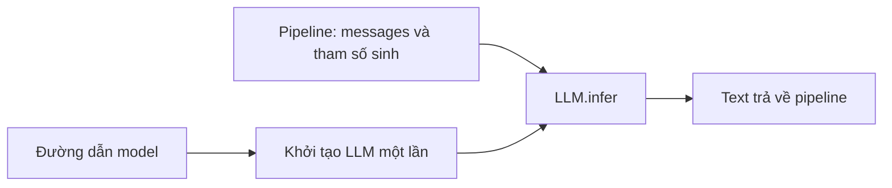
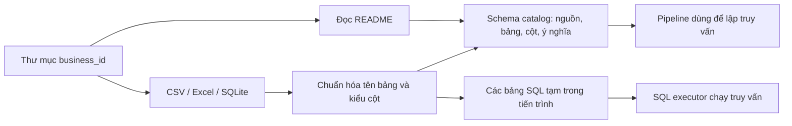
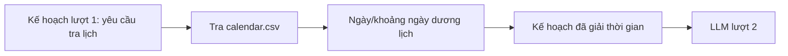
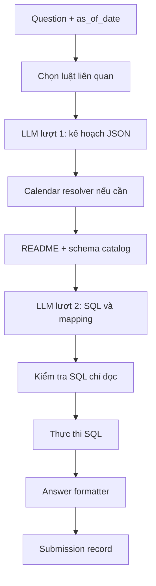
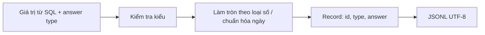
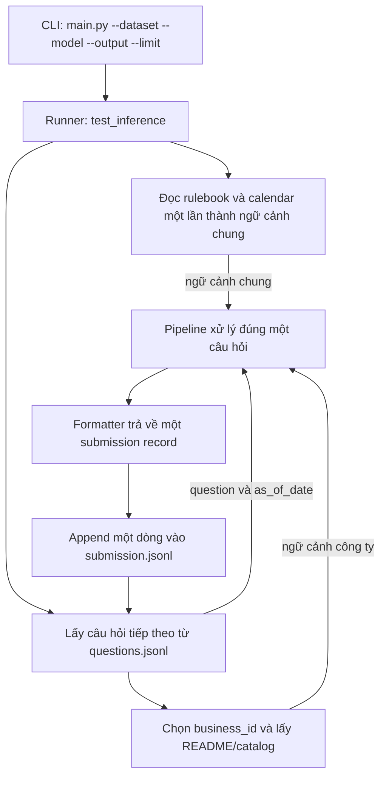

# DataMate — luồng inference dự kiến

Tài liệu này mô tả ranh giới các module của bản chạy thử. Các module trong sơ đồ đã có code; độ chính xác của hai lượt lập kế hoạch LLM cần được đo trên bộ train.

## 1. `llm` — gọi model

Pipeline chỉ cần một đối tượng tuân theo hợp đồng `BaseLLM.infer`. Cách nạp và chạy model nằm bên trong module `llm`; sơ đồ này không phụ thuộc vào runtime cụ thể.

## 2. `catalog` — nạp dữ liệu doanh nghiệp

“Bảng SQL tạm” nghĩa là chương trình đọc các file CSV/Excel/SQLite của một công ty và tạo bảng DuckDB để truy vấn ngay trong tiến trình inference. Đây không phải database server hay nơi lưu dữ liệu lâu dài. Mỗi công ty chỉ nạp một lần trong một phiên chạy. Catalog giữ liên hệ từ bảng SQL về file và sheet gốc để có thể kiểm tra truy vấn. Database tạm nằm ngoài dataset và được xóa sau phiên chạy.

## 3. `calendar` — giải nghĩa thời gian âm lịch

LLM chỉ nhận diện nhu cầu tra lịch; code xác định ngày. Nếu ngày cần tra nằm ngoài dữ liệu lịch, pipeline đánh dấu thiếu căn cứ.

## 4. `pipeline` — điều phối một câu hỏi

Lượt 1 mô tả phép tính, luật, khoảng thời gian, bộ lọc, đơn vị và kiểu đáp án. Lượt 2 nối kế hoạch với bảng/cột thật. Kết quả SQL được kiểm tra trước khi xuất đáp án.

## 5. `answer` — định dạng và kiểm tra đáp án

`number` yêu cầu phân biệt `money`, `count` và `decimal`. `percent` dùng thang 0–100. `unanswerable` và `abstain` không có `answer`. Thứ tự của `list` và `table` được giữ nguyên; pipeline phải tính đúng thứ tự theo rulebook trước khi gọi formatter.

## 6. `main.py` và `test_inference` — chạy một tập câu hỏi

`main.py` là entrypoint duy nhất. `--dataset` trỏ đến thư mục gốc chứa `questions.jsonl`, `rulebook.md`, `calendar.csv` và `data/<business_id>/`. `--model` nhận đường dẫn model MLX; `--output` là đường dẫn JSONL; `--limit` giới hạn số câu khi thử nhanh. Rulebook và calendar được đọc một lần để dùng lại; runner chỉ ghi một dòng sau khi pipeline hoàn tất câu hỏi tương ứng. Lỗi ở một câu được ghi ra stderr và câu đó được đánh dấu `abstain`.
